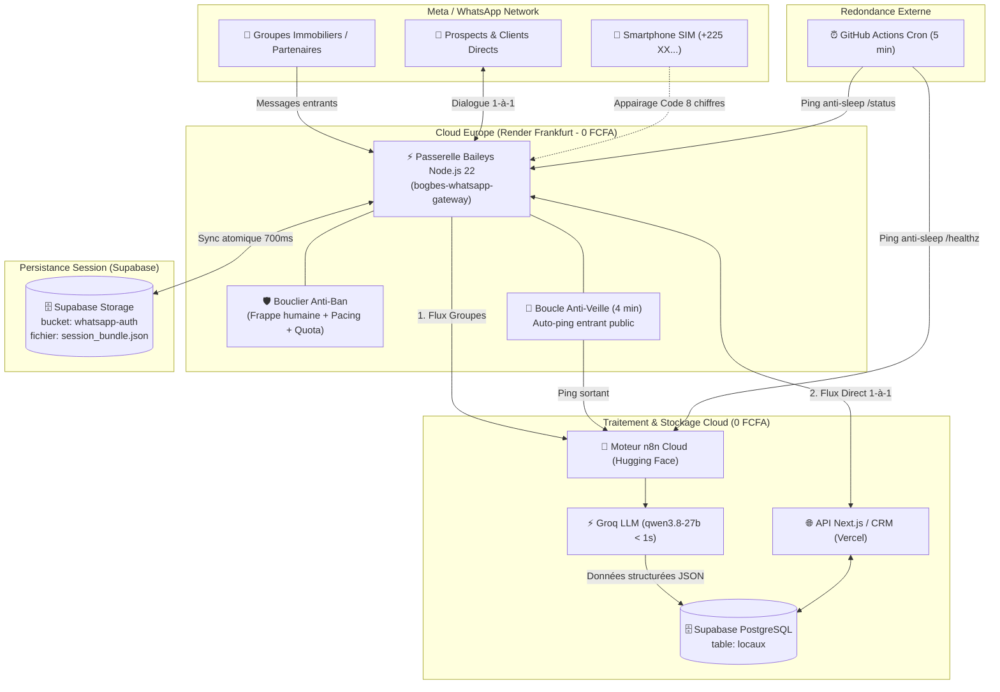

# WhatsApp Sovereign Cloud Gateway (0 FCFA/mois)

Guide de référence et patron d'ingénierie complet pour concevoir, déployer et exploiter une passerelle WhatsApp multi-appareils **100% Cloud, autonome 24h/24 et gratuite (0 FCFA/mois)**, en remplacement définitif des plateformes payantes tierces (Wasender, Twilio, UltraMsg, etc.), avec **blindage anti-bannissement opérateur, persistance de session dans Supabase Cloud et protocole anti-sommeil symbiotique**.

---

## ⚡ Pourquoi cette Architecture ?

Les plateformes SaaS tierces (Wasender, UltraMsg, Maytapi, Twilio) posent 4 risques majeurs :
1. **Coût récurrent élevé :** 30 $ à 100 $/mois par numéro sans garantie de maintien dans le temps.
2. **Coupures brutales :** Expirations de carte bancaire, arrêts de service ou changements d'API bloquant votre pipeline de scraping et votre CRM.
3. **Absence de souveraineté :** Vos données clients et vos flux immobiliers transitent par des serveurs tiers opaques.
4. **Fragilité des sessions :** Perte fréquente de session forçant des scans de QR répétitifs.

Cette solution déploie **votre propre passerelle Baileys privée** sur un conteneur Cloud gratuit en Europe, garantissant :
* **0 FCFA/mois** d'abonnement à vie.
* **100% Cloud :** Totalement indépendant du PC de l'utilisateur (le PC peut être éteint 24h/24).
* **Persistance Totale :** Clés cryptographiques de session WhatsApp sauvegardées atomiquement dans Supabase Cloud Storage (`session_bundle.json`).
* **Anti-Veille Symbiotique :** Aucun arrêt de conteneur grâce à l'auto-ping public toutes les 4 minutes.
* **Double flux automatique :** Groupes WhatsApp ➔ Pipeline de Scraping (n8n/LLM), Messages directs 1-à-1 ➔ CRM / Sapphire IA.

---

## 🏗️ Architecture Globale du Système



---

## ⚠️ Les 2 Pièges Critiques du Cloud Gratuit (À Résoudre Absolument)

### 1. Le Piège des Datacenters US (AWS)
> [!CAUTION]
> Si Baileys est hébergé sur un conteneur standard aux États-Unis (ex: Hugging Face Spaces standard hébergé sur AWS us-east-1), **Meta rejette immédiatement la connexion TLS** (`SSL alert number 0` ou timeout 408) car les plages d'IP cloud US sont classées comme fermes de bots.
> 
> **Règle absolue :** Toujours héberger la passerelle Baileys sur un **datacenter en Europe** (ex: **Frankfurt** sur **Render.com**, Paris sur **Koyeb** ou **Fly.io**). Meta autorise nativement les WebSockets sur ces régions.

### 2. Le Piège de la Mise en Veille Render (15 min d'inactivité)
> [!WARNING]
> Sur le plan gratuit Render, les conteneurs s'endorment après 15 minutes sans requête **HTTP entrante**.
> Bien que WhatsApp soit connecté par WebSocket sortant, Render **ne compte pas les WebSockets comme de l'activité HTTP**.
> Sans auto-ping entrant, le conteneur s'endort et le scraping s'arrête net.
> 
> **Solution intégrée :** Le serveur ping sa propre URL publique toutes les 4 minutes. La requête traverse le proxy externe de Render et arrive comme une requête HTTP entrante légitime, remettant le compteur à zéro en continu.

---

## 🛠️ Implémentation Complète de la Passerelle (`server.js`)

Voici le code de production complet intégrant :
- Persistance Supabase Cloud Storage (sans dépendance npm supplémentaire, pur `fetch` natif)
- Boucle anti-veille 24h/24
- Bouclier anti-bannissement complet
- Routage dual-stream (Groupes ➔ n8n / Privé ➔ CRM)

```javascript
// services/whatsapp-gateway/server.js
import express from 'express';
import cors from 'cors';
import QRCode from 'qrcode';
import pino from 'pino';
import { existsSync, mkdirSync, readFileSync, writeFileSync, readdirSync } from 'node:fs';
import { resolve } from 'node:path';
import makeWASocket, {
  DisconnectReason,
  useMultiFileAuthState,
} from '@whiskeysockets/baileys';

const PORT = parseInt(process.env.PORT || '10000', 10);
const AUTH_DIR = process.env.AUTH_DIR || resolve(process.cwd(), 'auth');
const API_KEY = process.env.WHATSAPP_API_KEY || 'votre_cle_secrete_2026';
const WEBHOOK_URL = process.env.WEBHOOK_URL || 'https://votre-site.com/api/whatsapp/webhook';
const WEBHOOK_SECRET = process.env.WEBHOOK_SECRET || 'secret_signature_webhook';
const N8N_SCRAPER_URL = process.env.N8N_SCRAPER_URL || 'https://votre-n8n.hf.space/webhook/wassender-immobilier';
const N8N_HEALTH_URL = process.env.N8N_HEALTH_URL || 'https://votre-n8n.hf.space/healthz';
const PUBLIC_GATEWAY_URL = process.env.PUBLIC_URL || 'https://bogbes-whatsapp-gateway.onrender.com';
const SUPABASE_URL = process.env.SUPABASE_URL || 'https://votre-projet.supabase.co';
const SUPABASE_KEY = process.env.SUPABASE_KEY || process.env.SUPABASE_SERVICE_ROLE_KEY || '';

const logger = pino({ level: 'info' });

let sock = null;
let qrCodeDataUrl = null;
let currentPairingCode = null;
let connectionStatus = 'logged_out';
let connectedPhone = null;
let reconnectTimer = null;
let reconnectAttempts = 0;
let totalReceived = 0;
let totalForwarded = 0;
let lastMessageAt = null;

// ─── ☁️ GESTIONNAIRE DE SESSION CLOUD (SUPABASE STORAGE) ─────────────────────
// Élimine toute perte de session lors des redéploiements sur disque éphémère
async function restoreSessionFromCloud(dir) {
  if (!SUPABASE_URL || !SUPABASE_KEY) return false;
  try {
    logger.info('☁️ Recherche sauvegarde session dans Supabase Storage (whatsapp-auth)...');
    const res = await fetch(`${SUPABASE_URL}/storage/v1/object/authenticated/whatsapp-auth/session_bundle.json`, {
      headers: { Authorization: `Bearer ${SUPABASE_KEY}`, apikey: SUPABASE_KEY },
      signal: AbortSignal.timeout(15000),
    });
    if (!res.ok) {
      logger.info(`ℹ️ Aucune archive distante trouvée (${res.status}). Initialisation locale.`);
      return false;
    }
    const bundle = await res.json();
    if (!existsSync(dir)) mkdirSync(dir, { recursive: true });
    let count = 0;
    for (const [file, content] of Object.entries(bundle)) {
      writeFileSync(resolve(dir, file), content, 'utf8');
      count++;
    }
    logger.info(`✅ Session WhatsApp restaurée depuis Supabase Cloud (${count} fichiers injectés en mémoire).`);
    return true;
  } catch (err) {
    logger.warn(`⚠️ Erreur restauration cloud: ${err.message}`);
    return false;
  }
}

let syncTimeout = null;
async function backupSessionToCloud(dir) {
  if (!SUPABASE_URL || !SUPABASE_KEY || !existsSync(dir)) return;
  try {
    const files = readdirSync(dir).filter(f => f.endsWith('.json'));
    if (files.length === 0 || !files.includes('creds.json')) return;

    const bundle = {};
    for (const f of files) bundle[f] = readFileSync(resolve(dir, f), 'utf8');

    const res = await fetch(`${SUPABASE_URL}/storage/v1/object/whatsapp-auth/session_bundle.json`, {
      method: 'POST',
      headers: {
        Authorization: `Bearer ${SUPABASE_KEY}`,
        apikey: SUPABASE_KEY,
        'x-upsert': 'true',
        'Content-Type': 'application/json',
      },
      body: JSON.stringify(bundle),
      signal: AbortSignal.timeout(20000),
    });
    if (res.ok) {
      logger.info(`☁️ Sauvegarde session synchronisée vers Supabase (${files.length} clés sauvegardées).`);
    }
  } catch (err) {
    logger.warn(`⚠️ Erreur backup session: ${err.message}`);
  }
}

function triggerCloudSync(dir) {
  if (syncTimeout) clearTimeout(syncTimeout);
  syncTimeout = setTimeout(() => backupSessionToCloud(dir), 8000); // Debounce 8s
}

// ─── 🛡️ BOUCLIER ANTI-BAN : Pacing, Quotas & Frappe Humaine ─────────────────
const outboundQueue = [];
let isProcessingQueue = false;
let dailyOutboundCount = 0;
let lastOutboundResetDay = new Date().toDateString();
const MAX_DAILY_OUTBOUND = 100; // Plafond sécuritaire strict sur ligne de scraping

function checkDailyReset() {
  const today = new Date().toDateString();
  if (today !== lastOutboundResetDay) {
    dailyOutboundCount = 0;
    lastOutboundResetDay = today;
  }
}

async function enqueueOutboundMessage(task) {
  checkDailyReset();
  if (dailyOutboundCount >= MAX_DAILY_OUTBOUND) {
    throw new Error(`[Anti-Ban] Quota de sécurité atteint (${MAX_DAILY_OUTBOUND}/jour).`);
  }
  return new Promise((resolve, reject) => {
    outboundQueue.push({ task, resolve, reject });
    processOutboundQueue();
  });
}

async function processOutboundQueue() {
  if (isProcessingQueue || outboundQueue.length === 0) return;
  isProcessingQueue = true;

  while (outboundQueue.length > 0) {
    const item = outboundQueue.shift();
    try {
      if (!sock || connectionStatus !== 'connected') {
        throw new Error('Passerelle WhatsApp déconnectée');
      }
      const { to, text, content } = item.task;

      // 1. Simulation humaine "en train d'écrire..."
      try { await sock.sendPresenceUpdate('composing', to); } catch {}

      // 2. Délai dynamique selon la longueur du message (2s à 6s)
      const delayMs = Math.min(7000, 1800 + (text || '').length * 15) + Math.random() * 2000;
      await new Promise(r => setTimeout(r, delayMs));

      // 3. Pause naturelle
      try { await sock.sendPresenceUpdate('paused', to); } catch {}

      // 4. Envoi
      const res = await sock.sendMessage(to, content);
      dailyOutboundCount++;
      item.resolve(res);

      // 5. Cooldown anti-rafale entre deux messages (5 à 9 secondes)
      if (outboundQueue.length > 0) {
        await new Promise(r => setTimeout(r, 5000 + Math.random() * 4000));
      }
    } catch (err) {
      item.reject(err);
    }
  }
  isProcessingQueue = false;
}

function getReconnectDelay() {
  reconnectAttempts++;
  const base = Math.min(60000, 5000 * Math.pow(1.8, Math.min(reconnectAttempts - 1, 5)));
  return Math.floor(base + Math.random() * 4000);
}

// ─── ⚡ CONNEXION WHATSAPP (BAILEYS MULTI-DEVICE) ────────────────────────────
async function connectToWhatsApp() {
  if (reconnectTimer) { clearTimeout(reconnectTimer); reconnectTimer = null; }
  if (sock) {
    try { sock.ev.removeAllListeners(); sock.end(); } catch {}
    sock = null;
  }

  try {
    // 1. Restauration préalable depuis Supabase Cloud
    await restoreSessionFromCloud(AUTH_DIR);

    // 2. Initialisation état auth
    const { state, saveCreds } = await useMultiFileAuthState(AUTH_DIR);
    connectionStatus = 'connecting';

    sock = makeWASocket({
      logger: pino({ level: 'info' }),
      auth: state,
      browser: ['Windows', 'Chrome', '124.0.0.0'],
      connectTimeoutMs: 60000,
      defaultQueryTimeoutMs: 60000,
      keepAliveIntervalMs: 15000,
      syncFullHistory: false,
      shouldSyncHistoryMessage: () => false,
      markOnlineOnConnect: false, // Discrétion : pas de statut "en ligne" 24h/24
      appStateMacVerification: { patch: false, snapshot: false },
      options: {
        headers: {
          'User-Agent': 'Mozilla/5.0 (Windows NT 10.0; Win64; x64) AppleWebKit/537.36 (KHTML, like Gecko) Chrome/124.0.0.0 Safari/537.36',
          'Origin': 'https://web.whatsapp.com',
        },
      },
    });

    // Sauvegarde locale + réplication cloud
    sock.ev.on('creds.update', async () => {
      await saveCreds();
      triggerCloudSync(AUTH_DIR);
    });

    sock.ev.on('connection.update', async (update) => {
      const { connection, lastDisconnect, qr } = update;

      if (qr) {
        qrCodeDataUrl = await QRCode.toDataURL(qr, { width: 320, margin: 2 });
      }

      if (connection === 'close') {
        const statusCode = lastDisconnect?.error?.output?.statusCode;
        const shouldReconnect = statusCode !== DisconnectReason.loggedOut;
        const delay = getReconnectDelay();
        connectionStatus = 'logged_out';
        connectedPhone = null;

        if (shouldReconnect) {
          reconnectTimer = setTimeout(connectToWhatsApp, delay);
        } else {
          logger.error('Session déconnectée par Meta (Logged Out).');
        }
      } else if (connection === 'open') {
        reconnectAttempts = 0;
        connectionStatus = 'connected';
        connectedPhone = sock.user?.id ? sock.user.id.split(':')[0].replace(/\D/g, '') : null;
        logger.info(`✅ Connecté à WhatsApp ! Numéro: +${connectedPhone}`);
        triggerCloudSync(AUTH_DIR);
      }
    });

    // Ingestion et Routage des messages entrants
    sock.ev.on('messages.upsert', async ({ messages, type }) => {
      if (type !== 'notify') return;

      for (const msg of messages) {
        if (!msg.message) continue;
        totalReceived++;
        lastMessageAt = new Date().toISOString();
        const jid = msg.key.remoteJid || '';
        const fromMe = msg.key.fromMe || false;
        const isGroup = jid.endsWith('@g.us');

        const text =
          msg.message.conversation ||
          msg.message.extendedTextMessage?.text ||
          msg.message.imageMessage?.caption ||
          msg.message.videoMessage?.caption ||
          '';

        // 1. Groupes WhatsApp -> Scraper n8n
        if (isGroup && !fromMe && N8N_SCRAPER_URL) {
          totalForwarded++;
          fetch(N8N_SCRAPER_URL, {
            method: 'POST',
            headers: { 'Content-Type': 'application/json' },
            body: JSON.stringify({
              event: 'messages-group.received',
              data: { messages: [msg], message: msg, key: msg.key },
              sender: msg.key.participant || jid,
              from: jid,
              text,
              timestamp: Date.now(),
            }),
          }).catch(() => null);
        }

        // 2. Directs 1-à-1 -> CRM / Bot IA
        if (!isGroup && WEBHOOK_URL) {
          fetch(WEBHOOK_URL, {
            method: 'POST',
            headers: {
              'Content-Type': 'application/json',
              'X-Webhook-Signature': WEBHOOK_SECRET,
            },
            body: JSON.stringify({
              event: fromMe ? 'messages.sent' : 'messages.received',
              data: {
                id: msg.key.id,
                from: jid,
                body: text,
                fromMe,
                pushName: msg.pushName || '',
                timestamp: msg.messageTimestamp,
              },
            }),
          }).catch(() => null);
        }
      }
    });
  } catch (err) {
    logger.error('Erreur démarrage Baileys:', err);
    connectionStatus = 'logged_out';
    reconnectTimer = setTimeout(connectToWhatsApp, 8000);
  }
}

// ─── 🔄 BOUCLE ANTI-VEILLE SYMBIOTIQUE 24/7 ──────────────────────────────────
function startKeepAliveLoop() {
  const INTERVAL_MS = 4 * 60 * 1000; // Toutes les 4 minutes (< 15 min limite Render)
  logger.info('🔄 Démarrage de la boucle anti-veille 24/7 (cycle: 4 min)...');

  setTimeout(runPingCycle, 45000);
  setInterval(runPingCycle, INTERVAL_MS);

  async function runPingCycle() {
    // 1. Auto-ping sur sa propre URL publique (génère une requête HTTP entrante)
    if (PUBLIC_GATEWAY_URL) {
      try {
        const pingUrl = `${PUBLIC_GATEWAY_URL}/status`;
        const res = await fetch(pingUrl, { signal: AbortSignal.timeout(12000) });
        logger.info(`🏓 [Anti-Veille Render] Auto-ping public OK (status ${res.status})`);
      } catch (err) {
        logger.warn(`⚠️ [Anti-Veille Render] Auto-ping: ${err.message}`);
      }
    }

    // 2. Ping de n8n sur Hugging Face Space pour maintenir le conteneur actif
    if (N8N_HEALTH_URL) {
      try {
        const res = await fetch(N8N_HEALTH_URL, { signal: AbortSignal.timeout(12000) });
        logger.info(`🏓 [Anti-Veille n8n] Ping n8n Space OK (status ${res.status})`);
      } catch (err) {
        logger.warn(`⚠️ [Anti-Veille n8n] Ping: ${err.message}`);
      }
    }

    // 3. Sauvegarde de sécurité périodique de la session
    triggerCloudSync(AUTH_DIR);
  }
}

// ─── 🌐 API HTTP EXPRESS ────────────────────────────────────────────────────
const app = express();
app.use(cors());
app.use(express.json());

app.get('/status', (req, res) => {
  checkDailyReset();
  res.json({
    success: true,
    status: connectionStatus,
    phone: connectedPhone,
    stats: { received: totalReceived, forwarded: totalForwarded, lastMessageAt },
    antiBan: { dailyOutbound: dailyOutboundCount, dailyLimit: MAX_DAILY_OUTBOUND },
    timestamp: new Date().toISOString(),
  });
});

app.post('/api/pairing-code', async (req, res) => {
  const phone = (req.body.phone || '').replace(/\D/g, '');
  if (!phone || !sock) return res.status(400).json({ error: 'Numéro requis' });
  try {
    const code = await sock.requestPairingCode(phone);
    currentPairingCode = code;
    res.json({ success: true, code });
  } catch (err) {
    res.status(500).json({ error: err.message });
  }
});

app.post('/send-message', async (req, res) => {
  const { to, text } = req.body;
  if (!to) return res.status(400).json({ error: 'Destinataire requis' });
  try {
    let cleanTo = to.replace(/\D/g, '');
    if (!cleanTo.endsWith('@s.whatsapp.net') && !cleanTo.endsWith('@g.us')) {
      cleanTo = `${cleanTo}@s.whatsapp.net`;
    }
    const result = await enqueueOutboundMessage({
      to: cleanTo,
      text: text || '',
      content: { text: text || '' },
    });
    res.json({ success: true, id: result.key.id });
  } catch (err) {
    res.status(500).json({ error: err.message });
  }
});

app.listen(PORT, '0.0.0.0', () => {
  logger.info(`Passerelle WhatsApp Baileys active sur port ${PORT}`);
  connectToWhatsApp();
  startKeepAliveLoop();
});
```

---

### Étape 2 : Le Conteneur Docker (`Dockerfile`)

```dockerfile
# services/whatsapp-gateway/Dockerfile
FROM node:22-alpine

WORKDIR /app
RUN apk add --no-cache git python3 make g++

COPY package.json ./
RUN npm install --omit=dev

COPY server.js ./
RUN mkdir -p /app/auth && chown -R 1000:1000 /app
USER 1000

ENV PORT=10000
ENV AUTH_DIR=/app/auth
EXPOSE 10000

CMD ["node", "server.js"]
```

---

### Étape 3 : Le Fichier Blueprint Render Europe (`render.yaml`)

À placer à la racine de votre dépôt Git pour un déploiement 1-clic :

```yaml
# render.yaml
services:
  - type: web
    name: bogbes-whatsapp-gateway
    runtime: docker
    dockerfilePath: ./services/whatsapp-gateway/Dockerfile
    dockerContext: ./services/whatsapp-gateway
    region: frankfurt  # CRITIQUE : Région Europe (Meta n'interdit pas l'IP)
    plan: free         # 0 FCFA/mois à vie
    healthCheckPath: /status
    envVars:
      - key: PORT
        value: 10000
      - key: API_KEY
        value: votre_cle_secrete_2026
      - key: WEBHOOK_URL
        value: https://votre-domaine.com/api/whatsapp/webhook
      - key: WEBHOOK_SECRET
        value: votre_secret_de_signature
      - key: N8N_SCRAPER_URL
        value: https://votre-n8n.hf.space/webhook/wassender-immobilier
      - key: N8N_HEALTH_URL
        value: https://votre-n8n.hf.space/healthz
      - key: PUBLIC_URL
        value: https://bogbes-whatsapp-gateway.onrender.com
      - key: SUPABASE_URL
        value: https://votre-projet.supabase.co
      - key: SUPABASE_KEY
        value: votre_supabase_service_role_key
```

---

### Étape 4 : Initialiser le Bucket Supabase Storage (`whatsapp-auth`)

Exécutez ce script Node unique pour créer le bucket privé sécurisé :

```javascript
// scripts/init-supabase-bucket.mjs
import { createClient } from '@supabase/supabase-js';

const sb = createClient(process.env.SUPABASE_URL, process.env.SUPABASE_SERVICE_ROLE_KEY);
const { data, error } = await sb.storage.createBucket('whatsapp-auth', { public: false });
if (!error) console.log('✅ Bucket whatsapp-auth créé avec succès !');
```

---

### Étape 5 : Le Workflow GitHub Actions de Redondance (`keep-alive.yml`)

```yaml
# .github/workflows/keep-n8n-alive.yml
name: Keep Services Alive (Anti-Sleep)

on:
  schedule:
    - cron: '*/5 * * * *' # Toutes les 5 minutes
  workflow_dispatch:

jobs:
  ping-services:
    runs-on: ubuntu-latest
    timeout-minutes: 5
    steps:
      - name: Ping WhatsApp Gateway
        run: curl -s -o /dev/null -w "%{http_code}" https://bogbes-whatsapp-gateway.onrender.com/status
      - name: Ping n8n Space
        run: curl -s -o /dev/null -w "%{http_code}" https://kassio1-n8n-free.hf.space/healthz
```

---

## 🛡️ Les 6 Piliers Anti-Bannissement (Protection Maximale de la SIM)

| # | Protection | Comportement Technique | Risque Éliminé |
|---|---|---|---|
| **1** | **Écoute Passive Groupes** | Ne renvoie aucun `readMessages` (pas de coches bleues) sur les groupes surveillés. | Détection de bot par lecture instantanée massive. |
| **2** | **Frappe Humaine (`composing`)** | Émet `composing`, temporise 2 à 6 secondes (proportionnel au texte + gigue aléatoire), pause, puis transmet. | Détection de messages postés à 0 milliseconde. |
| **3** | **File Cadencée (Anti-Burst)** | FIFO asynchrone avec délai incompressible de 5 à 9 secondes entre 2 messages distincts. | Détection de pics de diffusion / spams massifs. |
| **4** | **Plafond Journalier Strict** | Blocage absolu au-delà de 100 messages/24h sur la ligne de scraping. | Emballement de boucle de code ou cold-mailing abusif. |
| **5** | **Backoff Reconnexion** | Espacement exponentiel des tentatives (5s, 10s, 20s... max 60s + gigue). | Bannissement pour tempête de reconnexions réseau. |
| **6** | **Discrétion de Présence** | `markOnlineOnConnect: false` et User-Agent Windows Chrome 124 officiel. | Bannissement pour compte connecté 24h/24 sans pause humaine. |

---

## 💬 FAQ : Utiliser le Numéro pour Échanger Normalement

> **Question fréquente :** *« Puis-je utiliser ce même numéro WhatsApp sur mon téléphone personnel pour discuter avec des amis ou des clients sans risquer de bannissement ? »*

**Réponse : OUI, c'est totalement sûr**, sous réserve de respecter ces règles simples :
1. **Multi-Appareils officiel :** Baileys s'enregistre comme une session *WhatsApp Web / Desktop* normale. Meta voit votre smartphone physique comme l'appareil maître.
2. **Vos conversations manuelles sont 100% humaines :** Quand vous écrivez depuis votre téléphone, Meta traite le trafic exactement comme n'importe quel utilisateur régulier.
3. **Le bot n'écrit jamais sur vos conversations personnelles :** Le bot écoute uniquement les groupes pour scraper et ne répond qu'aux requêtes API autorisées avec un délai humain de 5 à 9 secondes.
4. **Précautions indispensables :**
   - Ne pas utiliser ce numéro pour envoyer 50 messages promotionnels non sollicités à des inconnus d'un coup.
   - Ne pas lancer un second script Baileys local sur votre ordinateur en même temps (erreur 440 conflit).

---

## 🔍 Matrice de Diagnostic Rapide

* **Code 440 (`Stream Errored (conflict)`) :**
  * *Cause :* Le script tourne à la fois sur votre PC et sur Render Cloud.
  * *Action :* Éteignez le processus local (`pkill node` ou fermez le terminal local).
* **Code 408 / `SSL alert number 0` :**
  * *Cause :* Conteneur situé dans un datacenter AWS aux États-Unis.
  * *Action :* Déployez en région Frankfurt (Europe).
* **Code 401 (`Logged Out`) :**
  * *Cause :* Déconnexion manuelle effectuée depuis l'application mobile WhatsApp.
  * *Action :* Utilisez l'endpoint `/api/pairing-code` pour lier à nouveau en 10 secondes.
* **Scraping figé après quelques heures :**
  * *Cause :* La mise en veille Render s'est déclenchée car l'auto-ping s'est arrêté.
  * *Action :* Vérifiez que `PUBLIC_URL` est bien défini dans les variables d'environnement de Render.
