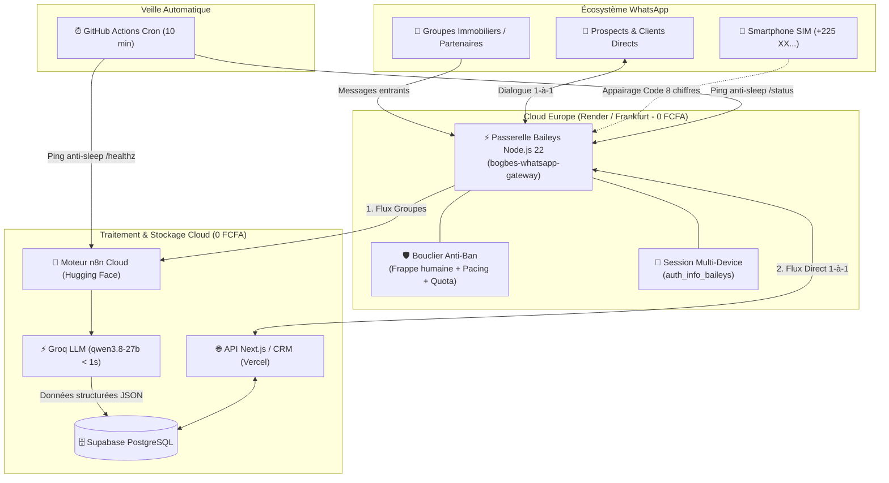

# WhatsApp Sovereign Cloud Gateway (0 FCFA/mois)

Guide de référence et patron de conception pour concevoir, déployer et exploiter une passerelle WhatsApp multi-appareils **100% Cloud, autonome 24h/24 et gratuite (0 FCFA/mois)**, en remplacement définitif des plateformes payantes tierces (Wasender, Twilio, etc.), avec **blindage anti-bannissement de niveau opérateur**.

---

## ⚡ Pourquoi cette Architecture ?

Les plateformes tierces comme Wasender, UltraMsg ou Maytapi posent 3 risques critiques :
1. **Coût récurrent élevé :** 30 $ à 100 $/mois par numéro sans garantie de pérennité.
2. **Coupures brutales :** Expirations de carte bancaire, pannes de serveurs tiers ou changements d'API bloquant votre CRM.
3. **Absence de souveraineté :** Vos messages transitent par des serveurs tiers non sécurisés.

Cette solution déploie **votre propre passerelle Baileys privée** directement sur un conteneur Cloud gratuit en Europe, garantissant :
* **0 FCFA/mois** d'abonnement.
* **100% Cloud (indépendant du PC allumé).**
* **Zéro coupure lors des redémarrages de machines locales.**
* **Double flux automatique :** Groupes WhatsApp ➔ Moteur de Scraping (n8n/LLM), Messages directs 1-à-1 ➔ CRM / Bot IA.

---

## 🏗️ Architecture Globale du Système



---

## ⚠️ Le Piège Critique des Datacenters Cloud (À Connaitre Impérativement)

> [!IMPORTANT]
> **Le blocage Meta sur les Datacenters US (AWS) :**
> Si vous tentez de faire tourner Baileys sur un conteneur hébergé dans un datacenter AWS US (comme les espaces gratuits Hugging Face standard), **Meta rejette et ferme la connexion TLS** (`SSL alert number 0` / timeout 408) car leur plage d'IP est classée "ferme de bots".
> 
> **La Règle d'Or :** Toujours déployer le service de la passerelle WhatsApp sur un **datacenter en Europe** (ex: **Frankfurt** ou **Paris** sur **Render.com**, **Fly.io** ou **Koyeb**). Meta ne bloque pas les protocoles WebSockets sur ces régions européennes.

---

## 🛠️ Implémentation Étape par Étape (De Zéro)

### Étape 1 : Le Serveur Passerelle (`server.js`)

Le cœur du système repose sur `@whiskeysockets/baileys` et `express` :

```javascript
// services/whatsapp-gateway/server.js
import express from 'express';
import cors from 'cors';
import QRCode from 'qrcode';
import pino from 'pino';
import { existsSync, mkdirSync } from 'node:fs';
import { resolve } from 'node:path';
import makeWASocket, {
  DisconnectReason,
  useMultiFileAuthState,
} from '@whiskeysockets/baileys';

const PORT = parseInt(process.env.PORT || '10000', 10);
const AUTH_DIR = process.env.AUTH_DIR || resolve(process.cwd(), 'auth');
const API_KEY = process.env.WHATSAPP_API_KEY || 'votre_cle_secrete_2026';
const WEBHOOK_URL = process.env.WEBHOOK_URL || 'https://votre-site.com/api/whatsapp/webhook';
const WEBHOOK_SECRET = process.env.WEBHOOK_SECRET || 'secret_signature_webhook';
const N8N_SCRAPER_URL = process.env.N8N_SCRAPER_URL || 'https://votre-n8n.hf.space/webhook/scraper';

const logger = pino({ level: 'info' });

let sock = null;
let qrCodeDataUrl = null;
let currentPairingCode = null;
let connectionStatus = 'logged_out';
let connectedPhone = null;
let reconnectTimer = null;
let reconnectAttempts = 0;

// ─── 🛡️ BOUCLIER ANTI-BAN : File cadencée & Pacing ─────────────────────────
const outboundQueue = [];
let isProcessingQueue = false;
let dailyOutboundCount = 0;
let lastOutboundResetDay = new Date().toDateString();
const MAX_DAILY_OUTBOUND = 100; // Plafond sécuritaire quotidien

function checkDailyReset() {
  const today = new Date().toDateString();
  if (today !== lastOutboundResetDay) {
    dailyOutboundCount = 0;
    lastOutboundResetDay = today;
  }
}

async function enqueueOutboundMessage(task) {
  checkDailyReset();
  if (dailyOutboundCount >= MAX_DAILY_OUTBOUND) {
    throw new Error(`[Anti-Ban] Quota journalier atteint (${MAX_DAILY_OUTBOUND}/jour).`);
  }
  return new Promise((resolve, reject) => {
    outboundQueue.push({ task, resolve, reject });
    processOutboundQueue();
  });
}

async function processOutboundQueue() {
  if (isProcessingQueue || outboundQueue.length === 0) return;
  isProcessingQueue = true;

  while (outboundQueue.length > 0) {
    const item = outboundQueue.shift();
    try {
      if (!sock || connectionStatus !== 'connected') {
        throw new Error('Passerelle WhatsApp déconnectée');
      }
      const { to, text, content } = item.task;

      // 1. Simulation présence "en train d'écrire..."
      try { await sock.sendPresenceUpdate('composing', to); } catch {}

      // 2. Délai humain proportionnel au message (2.5s à 7s)
      const humanDelayMs = Math.min(8000, 1800 + (text || '').length * 18) + Math.random() * 2000;
      await new Promise(r => setTimeout(r, humanDelayMs));

      // 3. Pause naturelle
      try { await sock.sendPresenceUpdate('paused', to); } catch {}

      // 4. Transmission
      const res = await sock.sendMessage(to, content);
      dailyOutboundCount++;
      item.resolve(res);

      // 5. Espacement anti-rafale (5s à 9s entre deux messages différents)
      if (outboundQueue.length > 0) {
        await new Promise(r => setTimeout(r, 5000 + Math.random() * 4000));
      }
    } catch (err) {
      item.reject(err);
    }
  }
  isProcessingQueue = false;
}

// ─── 🔄 RECONNEXION INTELLIGENTE AVEC EXPONENTIAL BACKOFF ─────────────────
function getReconnectDelay() {
  reconnectAttempts++;
  const base = Math.min(60000, 5000 * Math.pow(1.8, Math.min(reconnectAttempts - 1, 5)));
  return Math.floor(base + Math.random() * 4000);
}

// ─── ⚡ CONNEXION BAILEYS ───────────────────────────────────────────────────
async function connectToWhatsApp() {
  if (reconnectTimer) { clearTimeout(reconnectTimer); reconnectTimer = null; }
  if (sock) {
    try { sock.ev.removeAllListeners(); sock.end(); } catch {}
    sock = null;
  }

  try {
    const { state, saveCreds } = await useMultiFileAuthState(AUTH_DIR);
    connectionStatus = 'connecting';

    sock = makeWASocket({
      logger: pino({ level: 'info' }),
      auth: state,
      browser: ['Windows', 'Chrome', '124.0.0.0'],
      connectTimeoutMs: 60000,
      defaultQueryTimeoutMs: 60000,
      keepAliveIntervalMs: 15000,
      syncFullHistory: false,
      shouldSyncHistoryMessage: () => false,
      markOnlineOnConnect: false, // Discrétion : pas de statut "en ligne" 24h/24
      appStateMacVerification: { patch: false, snapshot: false },
      options: {
        headers: {
          'User-Agent': 'Mozilla/5.0 (Windows NT 10.0; Win64; x64) AppleWebKit/537.36 (KHTML, like Gecko) Chrome/124.0.0.0 Safari/537.36',
          'Origin': 'https://web.whatsapp.com',
        },
      },
    });

    sock.ev.on('creds.update', saveCreds);

    sock.ev.on('connection.update', async (update) => {
      const { connection, lastDisconnect, qr } = update;

      if (qr) {
        qrCodeDataUrl = await QRCode.toDataURL(qr, { width: 320, margin: 2 });
      }

      if (connection === 'close') {
        const statusCode = lastDisconnect?.error?.output?.statusCode;
        const shouldReconnect = statusCode !== DisconnectReason.loggedOut;
        const delay = getReconnectDelay();
        connectionStatus = 'logged_out';
        connectedPhone = null;

        if (shouldReconnect) {
          reconnectTimer = setTimeout(connectToWhatsApp, delay);
        } else {
          logger.error('Session déconnectée (Logged Out). Reconnexion manuelle requise.');
        }
      } else if (connection === 'open') {
        reconnectAttempts = 0;
        connectionStatus = 'connected';
        connectedPhone = sock.user?.id ? sock.user.id.split(':')[0].replace(/\D/g, '') : null;
        logger.info(`✅ Connecté à WhatsApp ! Numéro: +${connectedPhone}`);
      }
    });

    // ─── DUAL ROUTING DES MESSAGES ─────────────────────────────────────────
    sock.ev.on('messages.upsert', async ({ messages, type }) => {
      if (type !== 'notify') return;

      for (const msg of messages) {
        if (!msg.message) continue;
        const jid = msg.key.remoteJid || '';
        const fromMe = msg.key.fromMe || false;
        const isGroup = jid.endsWith('@g.us');

        const text =
          msg.message.conversation ||
          msg.message.extendedTextMessage?.text ||
          msg.message.imageMessage?.caption ||
          '';

        // 1. Groupe WhatsApp -> Relai Scraping n8n
        if (isGroup && !fromMe && N8N_SCRAPER_URL) {
          fetch(N8N_SCRAPER_URL, {
            method: 'POST',
            headers: { 'Content-Type': 'application/json' },
            body: JSON.stringify({
              event: 'messages-group.received',
              data: { messages: [msg], message: msg, key: msg.key },
              sender: msg.key.participant || jid,
              from: jid,
              text,
            }),
          }).catch(() => null);
        }

        // 2. Message direct 1-à-1 -> Relai CRM / Bot IA
        if (!isGroup && WEBHOOK_URL) {
          fetch(WEBHOOK_URL, {
            method: 'POST',
            headers: {
              'Content-Type': 'application/json',
              'X-Webhook-Signature': WEBHOOK_SECRET,
            },
            body: JSON.stringify({
              event: fromMe ? 'messages.sent' : 'messages.received',
              data: {
                id: msg.key.id,
                from: jid,
                body: text,
                fromMe,
                pushName: msg.pushName || '',
                timestamp: msg.messageTimestamp,
              },
            }),
          }).catch(() => null);
        }
      }
    });
  } catch (err) {
    logger.error('Erreur initialisation WhatsApp:', err);
    connectionStatus = 'logged_out';
    reconnectTimer = setTimeout(connectToWhatsApp, 10000);
  }
}

// ─── API HTTP & APPAIRAGE PAR CODE À 8 CHIFFRES ────────────────────────────
const app = express();
app.use(cors());
app.use(express.json());

app.get('/status', (req, res) => {
  checkDailyReset();
  res.json({
    success: true,
    status: connectionStatus,
    phone: connectedPhone,
    antiBan: {
      dailyOutbound: dailyOutboundCount,
      dailyLimit: MAX_DAILY_OUTBOUND,
      queuePending: outboundQueue.length,
    },
  });
});

// Appairage sans caméra par Code WhatsApp (8 chiffres)
app.post('/auth/pair', async (req, res) => {
  const phone = (req.body.phone || '').replace(/\D/g, '');
  if (!phone || !sock) return res.status(400).json({ error: 'Numéro requis' });
  try {
    const code = await sock.requestPairingCode(phone);
    currentPairingCode = code;
    res.json({ success: true, pairingCode: code });
  } catch (err) {
    res.status(500).json({ error: err.message });
  }
});

// Envoi de message protégé par le Bouclier
app.post('/send-message', async (req, res) => {
  const { to, text } = req.body;
  if (!to) return res.status(400).json({ error: 'to requis' });
  try {
    let cleanTo = to.replace(/\D/g, '');
    if (!cleanTo.endsWith('@s.whatsapp.net') && !cleanTo.endsWith('@g.us')) {
      cleanTo = `${cleanTo}@s.whatsapp.net`;
    }
    const result = await enqueueOutboundMessage({
      to: cleanTo,
      text: text || '',
      content: { text: text || '' },
    });
    res.json({ success: true, id: result.key.id });
  } catch (err) {
    res.status(500).json({ error: err.message });
  }
});

app.listen(PORT, '0.0.0.0', () => {
  logger.info(`Passerelle WhatsApp active sur port ${PORT}`);
  connectToWhatsApp();
});
```

---

### Étape 2 : Le Conteneur Docker (`Dockerfile`)

Pour garantir un déploiement universel et portable :

```dockerfile
# services/whatsapp-gateway/Dockerfile
FROM node:22-alpine

WORKDIR /app
RUN apk add --no-cache git python3 make g++

COPY package.json ./
RUN npm install --omit=dev

COPY server.js ./
# Pré-embarquement facultatif d'une session déjà authentifiée
COPY auth/ /app/auth/

RUN chown -R 1000:1000 /app
USER 1000

ENV PORT=10000
ENV AUTH_DIR=/app/auth
EXPOSE 10000

CMD ["node", "server.js"]
```

---

### Étape 3 : Le Fichier Blueprint Render Europe (`render.yaml`)

À placer à la racine de votre projet Git pour un déploiement en 1 clic :

```yaml
# render.yaml
services:
  - type: web
    name: bogbes-whatsapp-gateway
    runtime: docker
    dockerfilePath: ./services/whatsapp-gateway/Dockerfile
    dockerContext: ./services/whatsapp-gateway
    region: frankfurt  # CRITIQUE : Région Europe (Meta ne bloque pas l'IP)
    plan: free         # 0 FCFA/mois à vie
    healthCheckPath: /status
    envVars:
      - key: PORT
        value: 10000
      - key: API_KEY
        value: votre_cle_secrete_2026
      - key: WEBHOOK_URL
        value: https://votre-domaine.com/api/whatsapp/webhook
      - key: WEBHOOK_SECRET
        value: votre_secret_de_signature
      - key: N8N_SCRAPER_URL
        value: https://votre-n8n.hf.space/webhook/scraper
      - key: N8N_HEALTH_URL
        value: https://votre-n8n.hf.space/healthz
      - key: PUBLIC_URL
        value: https://bogbes-whatsapp-gateway.onrender.com
      - key: SUPABASE_URL
        value: https://votre-projet.supabase.co
      - key: SUPABASE_KEY
        value: votre_supabase_service_role_key
```

---

### Étape 4 : La Double Protection Anti-Sommeil et Persistance Cloud

Sur le plan gratuit Render, les conteneurs s'endorment après 15 minutes sans requête HTTP entrante.
Pour éliminer tout risque d'arrêt :

1. **Auto-Ping Symbiotique Interne (4 minutes) :**
   Le serveur envoie un ping HTTP à sa propre URL publique toutes les 4 minutes (ce qui réinitialise le compteur d'inactivité de Render) et ping en même temps n8n sur Hugging Face Space.

2. **Persistance des Clés Baileys dans Supabase Storage :**
   Le dossier de session `/app/auth` est automatiquement synchronisé en 1 bundle compressé dans un bucket privé Supabase Storage (`whatsapp-auth/session_bundle.json`).
   Au redémarrage du conteneur, les clés cryptographiques sont immédiatement réinjectées, rendant la session 100% insensible aux disques éphémères.

3. **Workflow GitHub Actions Externe (5 minutes) :**
Ajoutez ce workflow GitHub Actions en redondance externe :

```yaml
# .github/workflows/keep-alive.yml
name: Keep Services Alive (Anti-Sleep)

on:
  schedule:
    - cron: '*/5 * * * *' # Toutes les 5 minutes
  workflow_dispatch:

jobs:
  ping-services:
    runs-on: ubuntu-latest
    steps:
      - name: Ping WhatsApp Gateway
        run: curl -s -o /dev/null -w "%{http_code}" https://votre-service.onrender.com/status
      - name: Ping n8n
        run: curl -s -o /dev/null -w "%{http_code}" https://votre-n8n.hf.space/healthz
```

---

## 🛡️ Les 6 Boucliers Anti-Bannissement (Spécifications Techniques)

| # | Protection | Comportement Technique | Risque Éliminé |
|---|---|---|---|
| **1** | **Écoute Passive Groupes** | Ne renvoie aucun `readMessages` (pas de coches bleues) sur les groupes de scraping. | Bannissement pour comportement d'indexation massive. |
| **2** | **Frappe Humaine (`composing`)** | Émet `composing`, attend 2,5 à 7s (selon longueur texte + jitter aléatoire), pause, puis envoie. | Détection de bot par vitesse d'envoi mécanique (0 ms). |
| **3** | **File Cadencée (Anti-Burst)** | FIFO asynchrone avec délai incompressible de 5 à 9 secondes entre deux envois différents. | Détection de pics de diffusion / spams massifs. |
| **4** | **Quota de Sécurité Quotidien** | Bloque tout envoi au-delà de 100 messages/24h sur la ligne de scraping. | Emballement d'une boucle logicielle ou tentative de cold-spam. |
| **5** | **Backoff Reconnexion** | Espacement exponentiel des tentatives (5s, 10s, 20s... max 60s + gigue). | Bannissement pour "reconnect storm" suite à coupure réseau. |
| **6** | **Discrétion de Présence** | `markOnlineOnConnect: false` et User-Agent Windows Chrome 124. | Bannissement pour compte connecté 24h/24 sans interaction humaine. |

---

## 🔍 Matrice de Dépannage (Codes d'Erreurs Baileys)

* **Code 440 (`Stream Errored (conflict)`) :**
  * *Cause :* Deux serveurs (ex: votre PC local et Render Cloud) essaient de se connecter en même temps avec la même session WhatsApp.
  * *Solution :* Coupez immédiatement l'instance locale pour laisser l'instance Cloud seule maîtresse.
* **Code 408 / `SSL alert number 0` :**
  * *Cause :* Déploiement sur un datacenter US (AWS/Hugging Face direct) bloqué par Meta.
  * *Solution :* Déployez en région Europe (Frankfurt sur Render, Paris sur Koyeb).
* **Code 401 (`Logged Out`) :**
  * *Cause :* L'utilisateur a déconnecté la session depuis son téléphone (« Appareils connectés »).
  * *Solution :* Demandez un nouveau code d'appairage à 8 chiffres via `/auth/pair`.
